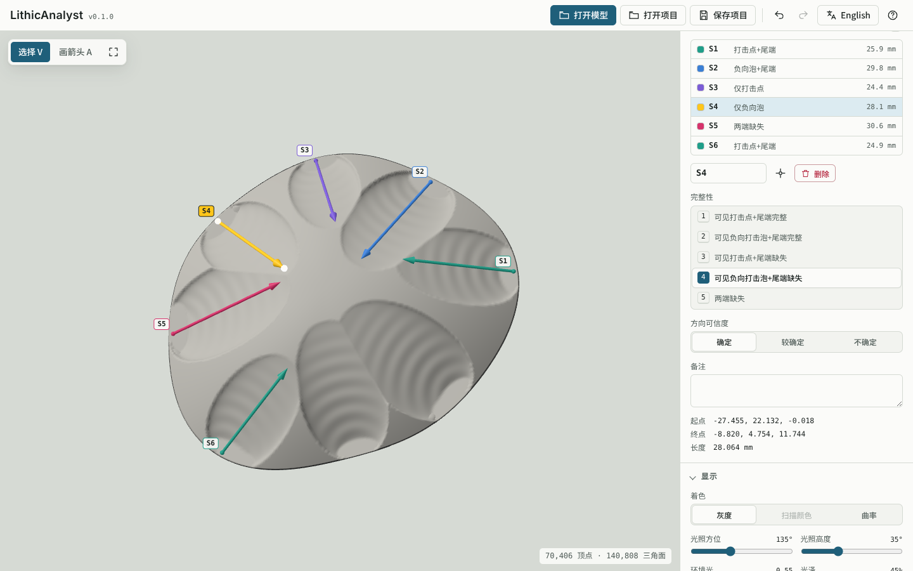

[](https://github.com/PeiyuanXiao/LithicAnalyst/releases)
[](https://github.com/PeiyuanXiao/LithicAnalyst/commits/main)
[](https://github.com/PeiyuanXiao/LithicAnalyst/actions/workflows/ci.yml)
[](LICENSE)
<!-- After the first release is archived on Zenodo:
[](https://doi.org/10.5281/zenodo.XXXXXXX)
-->
<!-- [](https://orcid.org/0000-0000-0000-0000) -->

# LithicAnalyst: 3D annotation and measurement of stone artefacts

LithicAnalyst records and measures 3D models of stone artefacts in the web browser. It is a single HTML file that works offline, and models and data never leave your computer.



- **Annotate**: flake scar directions, curves that follow ridges and valleys, surface regions (scars, cortex, retouch …), which scar cuts which, removal sequences with a live Harris matrix, and landmarks.
- **Measure**: dimensions, surface area and volume; for flakes, the technological axis, platform width, depth and angles, edge angles along an edge, and retouch indices (ERP, GIUR, invasiveness, curvature); for cores, the volumetric configuration.
- **Morphometrics**: fixed landmarks with curve and surface semilandmarks, exported with their sliding definitions for geomorph and Morpho.
- **Figures**: standard orthographic views with a scale bar, as PNG or SVG.
- **Compare and batch**: agreement between observers, and whole folders of models in one go.
- Cores, flakes, or a general type with nothing preset. The interface is in English, Chinese, Italian and French.

### Citation

If you use LithicAnalyst in your research, please cite the version you used:

> Xiao, P. (2026). *LithicAnalyst* (Version 0.1.0) [Computer software]. GitHub. https://github.com/PeiyuanXiao/LithicAnalyst

and refer to it in your text, for example:

> "Scar directions were recorded and edge angles measured with LithicAnalyst (Version 0.1.0; Xiao, 2026)."

The About page in the app (the **?** button) gives the reference for the version you have, with a button to copy it. **Cite this repository** on this page gives it in APA and BibTeX. A BibTeX entry:

```bibtex
@software{Xiao_LithicAnalyst_2026,
  author  = {Xiao, Peiyuan},
  title   = {{LithicAnalyst}},
  year    = {2026},
  version = {0.1.0},
  url     = {https://github.com/PeiyuanXiao/LithicAnalyst}
}
```

Several measurements follow published methods: edge angles after Schunk et al. (2023), ERP after Morales et al. (2015), GIUR after Kuhn (1990), invasiveness after Clarkson (2002), edge curvature after Hiscock and Attenbrow (2003), and the volumetric configuration after the Logical Analytical System (Carbonell et al., 1999; Lombao et al., 2023). When you report those measures, please cite these papers too. Each method and its source are described in [docs/project-format.md](docs/project-format.md).

### Getting started

- **Download** `LithicAnalyst-<version>.html` from the [latest release](https://github.com/PeiyuanXiao/LithicAnalyst/releases/latest) and open it in Chrome or Edge. There is nothing to install.
- **Online**: <https://peiyuanxiao.github.io/LithicAnalyst/>. In Chrome or Edge it can be installed as an app, with the install button in the address bar, and it then works offline too.
- Open a model (PLY, STL or OBJ), a folder of models, or a project file. In Chrome and Edge, projects and exports are saved in a `LithicAnalyst` folder next to the models. Firefox and Safari can read a folder but not write to it, so the project files are downloaded as a zip instead.
- Exports are CSV files, plus TPS and 3D Slicer `.fcsv` for landmarks, ready for R. The project file and every exported column are described in [docs/project-format.md](docs/project-format.md).
- Press **?** in the app for the keyboard shortcuts.

To build it from source (Node.js 20 or later):

```sh
npm ci
npm run build    # writes dist/index.html
npm test
```

### Contributing and getting help

Questions, problems and feature requests are welcome as [GitHub issues](https://github.com/PeiyuanXiao/LithicAnalyst/issues/new/choose), or by e-mail to pyxiao.sci@gmail.com. To contribute code, see [CONTRIBUTING.md](CONTRIBUTING.md). What has changed between versions is in [CHANGELOG.md](CHANGELOG.md).

<!-- AI assistance statement: to be written by the author. -->

### License

MIT © 2026 Peiyuan Xiao, see [LICENSE](LICENSE). Please keep the copyright and licence notice when you modify or redistribute it. Bundled with the app: three.js and three-mesh-bvh (MIT), and the IBM Plex fonts (SIL Open Font License 1.1).
