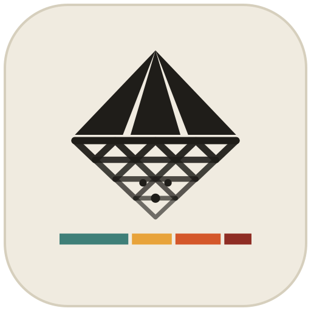

# LithicAnalyst <a href="https://github.com/PeiyuanXiao/LithicAnalyst"></a>

<!-- badges: start -->

[](https://www.repostatus.org/#active)
[](https://github.com/PeiyuanXiao/LithicAnalyst/releases/latest)
<!-- [](https://doi.org/10.5281/zenodo.XXXXXXX) -->
[](https://opensource.org/licenses/MIT)
[](https://peiyuanxiao.github.io/LithicAnalyst/)
[](https://github.com/PeiyuanXiao/LithicAnalyst/actions/workflows/ci.yml)
[](https://github.com/PeiyuanXiao/LithicAnalyst/releases)
[](https://orcid.org/0009-0000-9733-5875)
<!-- badges: end -->

**LithicAnalyst** is a browser application for the 3D analysis of stone
artefacts. It brings together **annotation** (flake scar directions,
curves, surface regions, removal sequences with a live Harris matrix,
landmarks and semilandmarks), **automatic measurement** of cores and
flakes (dimensions, platform IPA and EPA, edge angles, retouch indices,
volumetric configuration), publication figures and observer agreement,
with exports ready for R. It
is a single HTML file that runs offline: models and data never leave
your computer.

Online app: <https://peiyuanxiao.github.io/LithicAnalyst/>

------------------------------------------------------------------------

### 📦 Installation

Nothing needs to be installed. Chrome or Edge is recommended; in
Firefox and Safari everything works, but a folder can be read and not
written to.

#### Option A — Use it online

Open <https://peiyuanxiao.github.io/LithicAnalyst/>. In Chrome or Edge it
can also be installed as an app (the install button in the address
bar): it then opens in a window of its own and works offline. A new
version arrives the next time it starts.

#### Option B — Download the single file

Download `LithicAnalyst-<version>.html` from the [latest
release](https://github.com/PeiyuanXiao/LithicAnalyst/releases/latest)
and open it in the browser. Keep the file to stay on one version, for
example for the whole of a project.

#### Option C — Build from source

``` bash
git clone https://github.com/PeiyuanXiao/LithicAnalyst.git
cd LithicAnalyst
npm ci
npm run build    # writes dist/index.html
```

Requires Node.js ≥ 20.

------------------------------------------------------------------------

### 🚀 Quick Start

1.  On the start page, choose the type of specimen: **Core**, **Flake**
    or **General**.
2.  Open a model (PLY, STL or OBJ) or a whole folder of models, and set
    the unit of its coordinates in the specimen panel.
3.  Annotate in **Annotate**, read the automatic measurements in
    **Measure**, and the retouch indices in **Retouch** (flakes). Press
    **?** for the keyboard shortcuts.
4.  **Export** from the bottom of the sidebar. With a folder open, the
    summary of the whole folder goes to
    `LithicAnalyst/exports/<YYYY-MM-DD_HHMMSS>/` inside it.
5.  Analyse the exports in R:

``` r
library(readr)
exp_dir <- "path/to/models/LithicAnalyst/exports/2026-11-08_153000"

# ── Measurements and scars ────────────────────────────────
measurements <- read_csv(file.path(exp_dir, "measurements.csv"))  # one row per specimen
scars        <- read_csv(file.path(exp_dir, "scar_vectors.csv"))  # one row per scar

# ── Landmarks and semilandmarks ───────────────────────────
library(geomorph)
coords <- readland.tps(file.path(exp_dir, "gm_landmarks.tps"), specID = "ID")
```

------------------------------------------------------------------------

### 🔧 Feature Reference

#### Annotation

| Tool | Key | Description |
|:---|:---|:---|
| Draw arrow | A | Direction of a flake scar, from the point of percussion to the termination; completeness and termination type |
| Draw curve | P | Polyline on the surface that follows ridges and valleys: scar outlines, edges, platform outlines |
| Region | R | Surfaces bounded by curves: scar, cortex, joint, damage, retouch; a flake’s platform, ventral and dorsal faces |
| Relation, Sequence | B, Q | Which scar cuts which, and removal sequences, with a live Harris matrix |
| Landmark | K | Named fixed landmarks; curve semilandmarks along curves |
| Technological axis | T | A flake’s axis from the point of percussion, which sets its coordinate system |
| Working edge | W | Stretches of an edge (E1, E2 …) measured on their own |

#### Measurement

| Measure | Description |
|:---|:---|
| Dimensions | Length, width and thickness along a flake’s technological axis or the specimen’s orientation; morphological length, width and thickness |
| Surface area, volume | Of the whole model (volume on closed meshes only) |
| Platform | Width and depth (straight and along the surface), area; exterior platform angle (EPA, up to 3 mm from the edge as in Grosman et al., 2022) and interior platform angle (IPA) |
| Edge angles | Every 1 mm along an edge, at 2, 5 and 10 mm from it, by the three-point and two-line methods (Schunk et al., 2023); the parts of an edge sharper than a threshold |
| Volumetric configuration | Cores: faciality, flaking surfaces and their relations, platforms and polarity, on a box or bicone model, drawing on the Logical Analytical System |
| Cortex | Cortex ratio, and a sphere fitted to the cortex |
| Manual | Distances (straight and along the surface), angles, sections |

#### Retouch (flakes)

| Index | Description |
|:---|:---|
| ERP | Estimated reduction percentage, from original edges reconstructed in 3D (Morales et al., 2015) |
| GIUR | Geometric index of unifacial reduction (Kuhn, 1990) |
| Invasiveness | Index of invasiveness over 16 segments, and a continuous version (Clarkson, 2002) |
| Retouched perimeter | Share of the edge that is retouched, dorsal and ventral (Brumm & McLaren, 2011) |
| Edge curvature | R6/R3 of the longest retouched stretch (Hiscock & Attenbrow, 2003) |
| Retouch layers | Angles of each layer of retouch |

#### Morphometrics, Figures and Comparison

| Feature | Description |
|:---|:---|
| Semilandmarks | Along curves; on surfaces, a grid in a flake’s technological frame, or points laid on a template and carried to every specimen by thin-plate spline |
| Landmark exports | TPS, 3D Slicer `.fcsv` and CSV, with sliding definitions for geomorph and Morpho |
| Figures | Six orthographic views with a scale bar, as PNG or SVG; for one specimen or a folder |
| Compare | Agreement between observers: matched arrows and curves, region overlap, Cohen’s and Fleiss’ κ, ICC |
| Folders | Every model of a folder, its project files kept alongside, and summary exports |

The project file and every exported column are described in
[docs/project-format.md](docs/project-format.md).

------------------------------------------------------------------------

### 📝 Citation

If you use **LithicAnalyst** in your research, please cite the version
you used:

> Xiao, P. Y. (2026). *LithicAnalyst* (Version 0.1.0) [Computer software].
> GitHub. <https://github.com/PeiyuanXiao/LithicAnalyst>

and refer to it in your text, for example:

> “Scar directions were recorded with LithicAnalyst (Version 0.1.0;
> Xiao, 2026).”

The About page in the app (the **?** button) gives the reference for
the version you have, with a button to copy it; **Cite this
repository** on this page gives it in APA and BibTeX.

``` bibtex
@software{Xiao_LithicAnalyst_2026,
  author  = {Xiao, P. Y.},
  title   = {{LithicAnalyst}},
  year    = {2026},
  version = {0.1.0},
  url     = {https://github.com/PeiyuanXiao/LithicAnalyst}
}
```

------------------------------------------------------------------------

### 💬 Getting Help and Contributing

Questions, problems and feature requests are welcome as [GitHub
issues](https://github.com/PeiyuanXiao/LithicAnalyst/issues/new/choose)
or by e-mail to <pyxiao.sci@gmail.com>. To contribute code, see
[CONTRIBUTING.md](CONTRIBUTING.md); what has changed between versions
is in [CHANGELOG.md](CHANGELOG.md).

<!-- AI assistance statement: to be written by the author. -->

------------------------------------------------------------------------

### ⚖️ License

This project is licensed under the **MIT License** — see the
[LICENSE](LICENSE) file for details. © 2026 Peiyuan Xiao. Bundled with
the app: three.js and three-mesh-bvh (MIT), and the IBM Plex fonts (SIL
Open Font License 1.1).
